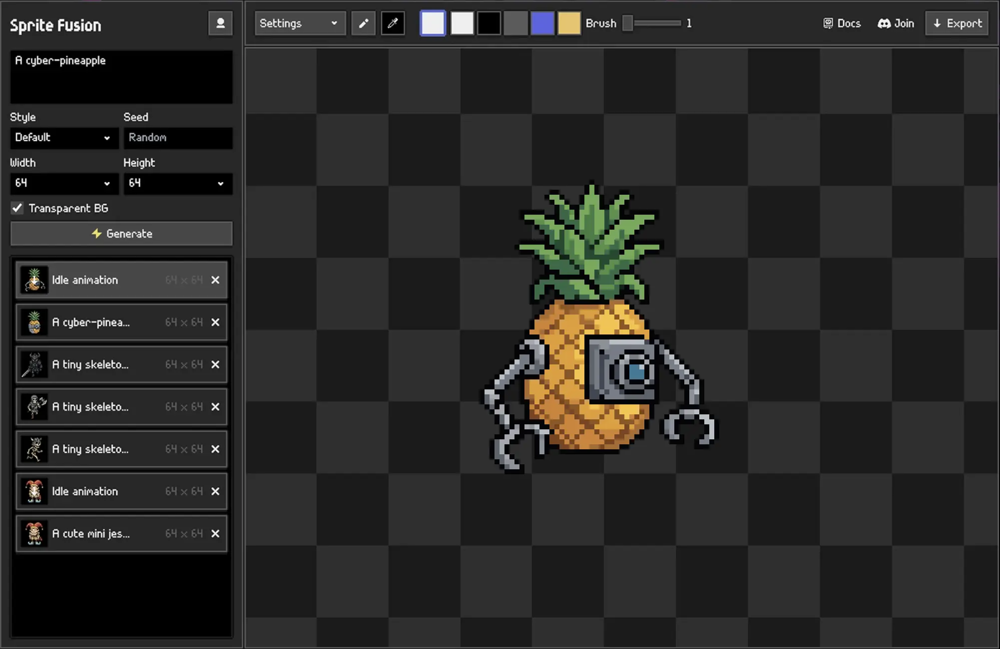

# Sprite Fusion for Unity

[Sprite Fusion](https://www.spritefusion.com/pixel-art-generator) is a professional pixel-art sprites and animations generator. This is the native plugin for the Unity editor.

## Installation

### Unity package (recommended)

1. Download the latest [Sprite Fusion Unity package](https://github.com/Hugo-Dz/spritefusion-unity/releases/latest/download/spritefusion.unitypackage).
2. Open your Unity project.
3. Select `Assets > Import Package > Custom Package`.
4. Select the downloaded `spritefusion.unitypackage`, then click `Import`.
5. Open `Window > Sprite Fusion` and connect your account.

### Manual installation from source

1. Open the [latest GitHub release](https://github.com/Hugo-Dz/spritefusion-unity/releases/latest).
2. Under **Assets**, download **Source code (zip)** and extract it.
3. Copy the extracted `Assets/SpriteFusion` folder into your Unity project's `Assets` folder.
4. Open the project in Unity and wait for the editor scripts to compile.
5. Open `Window > Sprite Fusion` and connect your account.

## Requirements

- Unity editor
- Sprite Fusion account

## Usage

1. Open `Window > Sprite Fusion`.
2. Click `Connect` and approve the device code in your browser.
3. Enter a prompt and click `Generate`.
4. Select a generated image, enter an animation prompt, and click `Animate`.

Generated assets are written to `Assets/SpriteFusion/Generated`.

## Useful links

- [Sprite Fusion website](https://www.spritefusion.com)
- [Unity plugin documentation](https://www.spritefusion.com/docs/pixel-art-generator/integrations/unity)
- [Latest GitHub release](https://github.com/Hugo-Dz/spritefusion-unity/releases/latest)

## License

This plugin is licensed under MIT.
